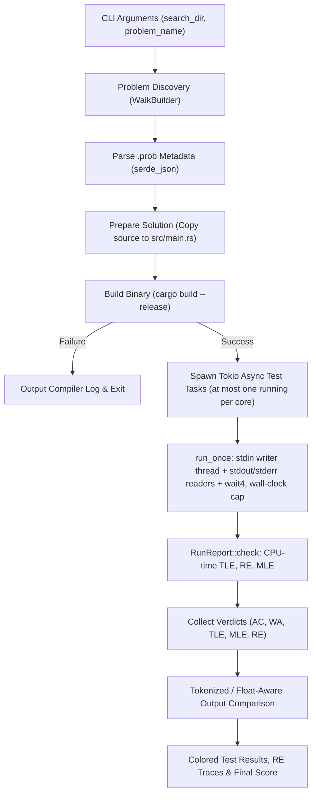

# Architecture: `cph_judge`

## Overview

`cph_judge` is a fast, parallel competitive programming judge written in Rust. It integrates with Competitive Companion / CPH problem metadata (`.prob` files), manages compilation of solution binaries, and evaluates test cases concurrently against resource limits (time, memory) and expected outputs.

---

## System Pipeline

---

## Key Modules and Components

### 1. Problem Discovery (`find_prob_file`)
- Uses `ignore::WalkBuilder` to traverse `search_dir` recursively.
- Finds `.prob` JSON files matching the specified target problem name.
- Resolves project root directory by inspecting parent directory structures.

### 2. Configuration & Metadata (`CphConfig`)
- Parses `.prob` files generated by Competitive Companion / CPH:
  - `name`: Problem name.
  - `interactive`: Boolean flag for interactive problems.
  - `timeLimit`: Execution time limit in milliseconds (defaults to 3000ms).
  - `memoryLimit`: Memory limit in megabytes (defaults to 256MB).
  - `srcPath`: Path to the source file.
  - `tests`: Array of input/output test case pairs.

### 3. Solution Compilation (`compile.rs`)
- Copies the solution file to the target crate's `src/main.rs`.
- Reads `Cargo.toml` to extract package/binary name (`package_name`).
- Executes `cargo build --release` (`build_release`), redirecting stderr to `compiler_log.txt`.
- Halts execution and prints logs if compilation fails.

### 4. Concurrent Execution Engine (`runner.rs`)
- `run_once` runs one process and returns a raw `RunReport` (exit status, stdout, stderr,
  CPU time, peak RSS). `RunReport::check` then applies `Limits` and yields a verdict. The two
  steps are separate so later features (checker, brute force, interactor) can reuse the raw run.
- Test cases run as `tokio::spawn` tasks around `tokio::task::spawn_blocking`, with a semaphore so
  **at most one test runs per core** (`available_parallelism`).
- `stdin` is written from its own thread, and `stdout`/`stderr` are drained by two more, so a
  program that streams output while still reading input cannot deadlock the judge.
- `wait4::Wait4` returns the exit status and resource usage: user + system **CPU time** and
  `rusage.maxrss`.
- The time limit is enforced on **CPU time**. A hard **wall-clock cap** of `2 × timeLimit + 500 ms`
  (`tokio::time::timeout`) kills processes that are blocked or sleeping and so never accumulate CPU
  time. Trade-off: an infinite loop is reported after the wall cap, not at the time limit.
- Processes past the wall cap are terminated with process-tree signal dispatching (`pkill -9 -P`
  and `kill -9`).

### 5. Verdict Evaluation

Checked in this order: TLE, RE, MLE, then output comparison.

| Verdict | Trigger Condition | Display |
|---|---|---|
| **AC** (Accepted) | Program exited successfully, output matches expected within tolerance | `✅ Test #N (CPU time, memory)` |
| **WA** (Wrong Answer) | Program exited successfully, output differs from expected | `❌ Test #N` (Shows expected vs received) |
| **TLE** (Time Limit Exceeded) | CPU time exceeded `timeLimit`, or the wall-clock cap was hit | `⏱️ Test #N TLE (limit)` |
| **MLE** (Memory Limit Exceeded) | Peak RSS exceeded `memoryLimit` | `💾 Test #N MLE (limit)` |
| **RE** (Runtime Error) | Non-zero exit code, signal termination, or panic | `💥 Test #N RE (status)` with crash / panic trace |

### 6. Exit Codes

| Code | Meaning |
|---|---|
| 0 | Every test passed |
| 1 | Compilation failed, or at least one test did not pass |
| 2 | Usage error, or the judge itself could not run (e.g. `.prob` not found) |

### 7. Source Layout

| File | Contents |
|---|---|
| `src/main.rs` | CLI, problem discovery, orchestration, result printing |
| `src/compile.rs` | `package_name`, `build_release` |
| `src/runner.rs` | `run_once`, `RunReport::check`, `Limits`, `RunError` |
| `src/compare.rs` | `compare_outputs` |

Planned checker, interactive and stress features: see [`design-stress-interactive.md`](design-stress-interactive.md).

---

## Output Comparison Engine (`compare_outputs`)

Competitive programming solutions often output floating-point values that differ only in rounding or trailing zeros, or outputs that vary only by whitespace layout.

The judge uses token-by-token comparison:
1. Splits actual and expected outputs by whitespace into token streams.
2. Checks that token counts match.
3. For each token pair `(a, e)`:
   - If `a == e`, tokens match exactly (covers strings, integers, exact floats).
   - If both parse as valid finite `f64` values:
     - Absolute difference: $|a - e| \le 10^{-6}$
     - Relative difference: $\frac{|a - e|}{|e|} \le 10^{-6}$
     - Tokens match if either absolute or relative difference is within $\epsilon = 10^{-6}$.
   - Otherwise, tokens do not match.
