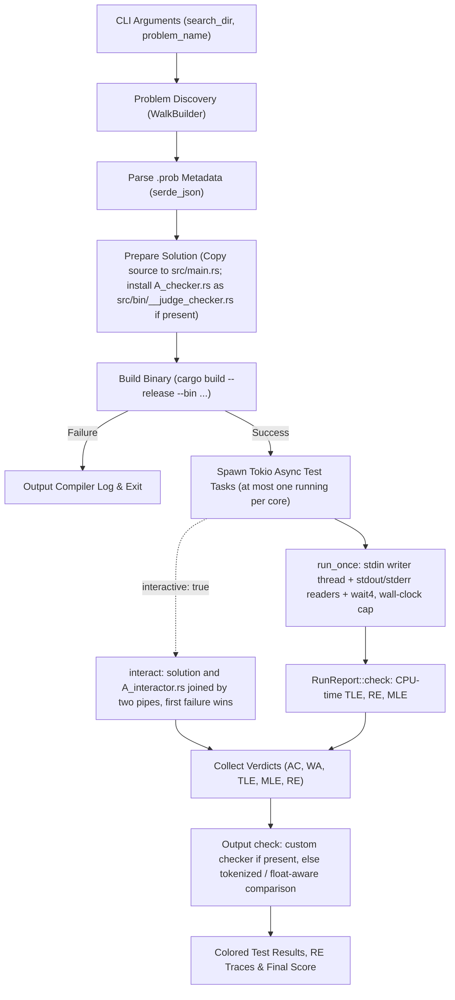

# Architecture: `cph_judge`

## Overview

`cph_judge` is a fast, parallel competitive programming judge written in Rust. It integrates with Competitive Companion / CPH problem metadata (`.prob` files), manages compilation of solution binaries, and evaluates test cases concurrently against resource limits (time, memory) and expected outputs.

---

## System Pipeline

---

## Key Modules and Components

### 1. Problem Discovery (`find_prob_file`)
- Uses `ignore::WalkBuilder` to traverse `search_dir` recursively.
- Finds `.prob` JSON files matching the specified target problem name.
- Resolves project root directory by inspecting parent directory structures.

### 2. Configuration & Metadata (`CphConfig`)
- Parses `.prob` files generated by Competitive Companion / CPH:
  - `name`: Problem name.
  - `interactive`: Boolean flag for interactive problems.
  - `timeLimit`: Execution time limit in milliseconds (defaults to 3000ms).
  - `memoryLimit`: Memory limit in megabytes (defaults to 256MB).
  - `srcPath`: Path to the source file.
  - `tests`: Array of input/output test case pairs.

### 3. Solution Compilation (`compile.rs`)
- Copies the solution file to the target crate's `src/main.rs`.
- Reads `Cargo.toml` to extract the package/binary name and the `autobins` setting (`package_info`).
- The verifier is chosen from the files next to the solution and the `.prob`'s `interactive` flag
  (`choose_verifier`): an interactive problem needs `<solution>_interactor.rs`; otherwise
  `<solution>_checker.rs` is used if present. The chosen file (`aux_source`) is copied by
  `GeneratedBins` to `src/bin/__judge_checker.rs` or `src/bin/__judge_interactor.rs` for the duration
  of the build and removed afterwards. With `autobins = false` this cannot work, so the judge exits
  with code 2 and an explanation.
- With `--stress` the generator and, for an ordinary problem, the brute force are built too
  (`__judge_gen`, `__judge_brute`).
- Executes `cargo build --release --bin <package> [--bin __judge_checker | --bin __judge_interactor] [--bin __judge_brute --bin __judge_gen]` (`build_release`),
  redirecting stderr to `compiler_log.txt`. Building via cargo keeps the project's edition, profile and
  dependencies for every binary.
- Halts execution and prints logs if compilation fails (a checker that does not compile fails the build).

### 4. Concurrent Execution Engine (`runner.rs`)
- `run_once` runs one process and returns a raw `RunReport` (exit status, stdout, stderr,
  CPU time, peak RSS). `RunReport::check` then applies `Limits` and yields a verdict. The two
  steps are separate so later features (checker, brute force, interactor) can reuse the raw run.
- Test cases run as `tokio::spawn` tasks around `tokio::task::spawn_blocking`, with a semaphore so
  **at most one test runs per core** (`available_parallelism`).
- `stdin` is written from its own thread, and `stdout`/`stderr` are drained by two more, so a
  program that streams output while still reading input cannot deadlock the judge.
- `wait4::Wait4` returns the exit status and resource usage: user + system **CPU time** and
  `rusage.maxrss`.
- The time limit is enforced on **CPU time**. While a process runs, a watcher polls every 10 ms and
  kills it once its CPU time exceeds the limit (Linux: user + system time from `/proc/<pid>/stat`,
  10 ms resolution), so an infinite loop is reported at the limit.
- A hard **wall-clock cap** of `2 × timeLimit + 500 ms` kills processes that are blocked or sleeping
  and so never accumulate CPU time. On platforms without `/proc` it is the only live enforcement,
  and an infinite loop is then reported after the cap instead of at the limit.
- Processes are terminated with process-tree signal dispatching (`pkill -9 -P` and `kill -9`).
  The watcher stops touching a pid as soon as the child has been reaped, because the pid may be reused.

### 5. Verdict Evaluation

Checked in this order: TLE, RE, MLE, then the output check.

The output check is the built-in comparison unless the solution has a checker (see below).

| Verdict | Trigger Condition | Display |
|---|---|---|
| **AC** (Accepted) | Program exited successfully, output matches expected within tolerance | `✅ Test #N (CPU time, memory)` |
| **WA** (Wrong Answer) | Program exited successfully, output differs from expected | `❌ Test #N` (Shows expected vs received) |
| **TLE** (Time Limit Exceeded) | CPU time exceeded `timeLimit` (killed live on Linux), or the wall-clock cap was hit | `⏱️ Test #N TLE (limit)` |
| **MLE** (Memory Limit Exceeded) | Peak RSS exceeded `memoryLimit` | `💾 Test #N MLE (limit)` |
| **RE** (Runtime Error) | Non-zero exit code, signal termination, or panic | `💥 Test #N RE (status)` with crash / panic trace |

### 6. Custom Checker (`checker.rs`)

When `<solution>_checker.rs` exists, it decides AC/WA instead of the built-in comparison. It runs as
`checker <input_file> <output_file> <answer_file>` (testlib argument order) on files written to
`<project>/target/judge/N.in`, `N.out`, `N.ans`, where `N.ans` is the expected output stored in the `.prob`.

| Checker exit | Verdict |
|---|---|
| 0 | AC |
| 1 | WA; the checker's stderr message is shown instead of expected/received |
| 2 | PE (shown as `Test #N PE`) |
| 3, any other code, a crash or a timeout | `checker failed (...)`: not counted as passed, never labelled WA |

The checker only runs for a program that finished within its limits.

### 7. Interactive Problems (`interactive.rs`)

With `"interactive": true` each test runs the solution against `<solution>_interactor.rs`, started as
`interactor <input_file>` where the input file is `<project>/target/judge/N.in` (the test's `input`).

- Two `std::io::pipe()` pairs connect interactor stdout to solution stdin and solution stdout to
  interactor stdin. The judge closes its own copies of the pipe ends as soon as both processes have
  started; otherwise a side closing its end would never be seen as EOF by the other.
- One supervisor thread per process gathers its status, stderr, CPU time, peak RSS and the time it was
  reaped; the async loop polls like `run_once` does.
- Limits: the solution is killed at its CPU limit and both at the wall-clock cap (reported as TLE, with
  a note if it was the cap). A solution still running after the interactor rejected it is killed at once;
  an interactor still running 250 ms after the solution failed is killed too.
- `decide` turns the two reports into a verdict. The interactor's exit code uses the same testlib
  mapping as checkers. **The first failure wins** (by reaping order) and the other side's failure
  becomes a note. If the solution left first and the interactor then died of SIGPIPE or panicked with
  `Broken pipe`, the verdict is a wrong answer ("the solution stopped reading ...").
- The interactor's verdict replaces the output comparison; a checker, if present, is ignored.

### 8. Stress Testing (`stress.rs`)

`--stress` replaces running the `.prob` tests with a search for a counterexample. After the build
(which now also builds `<solution>_gen.rs` and, for an ordinary problem, `<solution>_brute.rs`):

1. Each iteration runs `gen <seed> <size>`, then the oracle: the brute force plus the built-in comparison
   or the checker, or, for an interactive problem, the interactor. Sizes ramp from 1 to `maxSize`.
2. `first_failure` runs iterations in parallel chunks and returns the lowest failing index.
3. `find_smaller` shrinks a fault by trying smaller sizes with many seeds for a failure of the same kind.
4. The counterexample is printed and kept in `target/judge/stress/`; `--save` appends it to the `.prob`.

A failure is either a `Fault` of the solution (wrong answer, PE, TLE, MLE, RE) or a `Problem` with the
judge's own setup (generator, brute force, checker, interactor); only faults are counterexamples.
`first_failure` and `find_smaller` are generic over the trial function, so their ordering and shrinking
rules are unit-tested with fake evaluators.

### 9. Command Line and Hints (`cli.rs`, `hints.rs`)

`judge <search_dir> <problem_name> [--stress [--iters N] [--seed S] [--max-size N] [--save]]`.
Hints come from an optional `"stress"` object in the `.prob` and from a sidecar `<solution>.stress.json`
(which wins). They name the auxiliary files (resolved against the solution's directory, overriding the
`_suffix` convention) and tune the stress run; command-line options win over hints.

### 10. Exit Codes

| Code | Meaning |
|---|---|
| 0 | Every test passed (stress: no counterexample found) |
| 1 | Compilation failed, at least one test did not pass, or (stress) a counterexample was found |
| 2 | Usage error, or the judge itself could not run (e.g. `.prob` not found; stress: a problem with the generator, brute force, checker or interactor) |

### 11. Source Layout

| File | Contents |
|---|---|
| `src/main.rs` | CLI, problem discovery, orchestration, result printing |
| `src/compile.rs` | `package_info`, `aux_source`, `GeneratedBins`, `build_release` |
| `src/checker.rs` | `run_checker`, `interpret`, `exit_verdict` (testlib exit code → `Verdict`, shared with interactors) |
| `src/interactive.rs` | `run_interaction`, `decide`, `interact` |
| `src/stress.rs` | `evaluate`, `first_failure`, `find_smaller`, `run`, `save_counterexample` |
| `src/cli.rs` | `parse`, `USAGE` |
| `src/hints.rs` | `Hints`, `load` (the `.prob` object and the sidecar file) |
| `src/report.rs` | Printing shared by normal and stress mode |
| `src/runner.rs` | `run_once`, `RunReport::check`, `violation`, `Limits`, `RunError`, `format_exit_status` |
| `src/compare.rs` | `compare_outputs` |

Tests: unit tests live next to the code. `tests/checker.rs`, `tests/interactive.rs`, `tests/stress.rs` and
`tests/paths.rs` build throwaway Cargo projects (helpers in `tests/common/`) and run the real binary.

Planned generator inference: see [`design-stress-interactive.md`](design-stress-interactive.md).

---

## Output Comparison Engine (`compare_outputs`)

Competitive programming solutions often output floating-point values that differ only in rounding or trailing zeros, or outputs that vary only by whitespace layout.

The judge uses token-by-token comparison:
1. Splits actual and expected outputs by whitespace into token streams.
2. Checks that token counts match.
3. For each token pair `(a, e)`:
   - If `a == e`, tokens match exactly (covers strings, integers, exact floats).
   - If both parse as valid finite `f64` values:
     - Absolute difference: $|a - e| \le 10^{-6}$
     - Relative difference: $\frac{|a - e|}{|e|} \le 10^{-6}$
     - Tokens match if either absolute or relative difference is within $\epsilon = 10^{-6}$.
   - Otherwise, tokens do not match.
